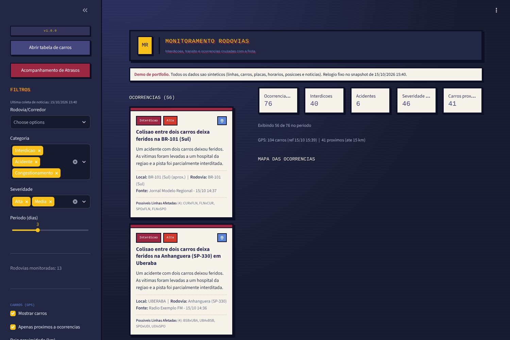
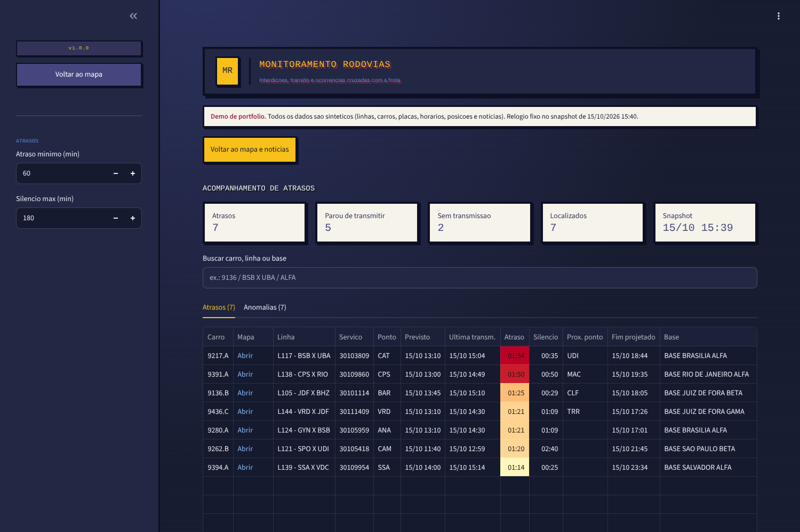
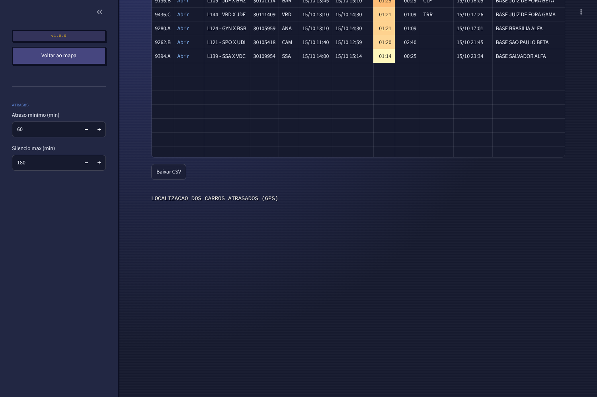
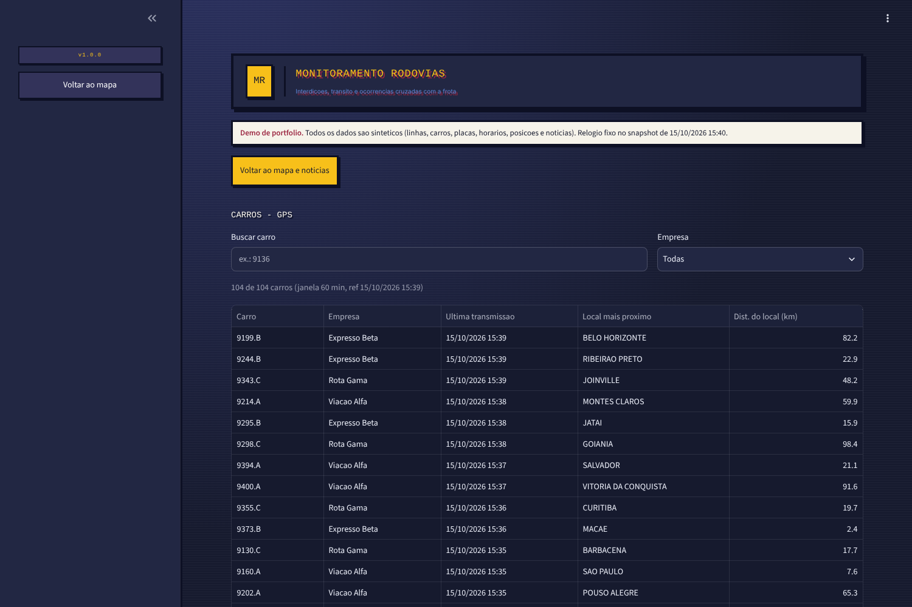

# Monitoramento de Rodovias

Painel em Python e Streamlit que reúne, em uma só tela, as ocorrências nas rodovias usadas pelas linhas de uma empresa de transporte rodoviário de passageiros (interdições, acidentes, obras, clima, congestionamentos), a posição GPS dos ônibus e o acompanhamento de atrasos das viagens.

> **Aviso: todos os dados deste repositório são sintéticos.** Linhas, carros, placas, horários, posições GPS e notícias foram gerados pelo script `scripts/gerar_dados_sinteticos.py` (seed fixa), sem derivar de nenhum registro real. Esta é uma versão de portfólio, separada do sistema em produção.

**Versão web:** https://danielmvr.github.io/monitoramento-rodovias-portifolio/
(roda o Streamlit no navegador via stlite; a primeira abertura leva de 15 a 30 segundos)

## Objetivo

A central de controle operacional precisa saber, rapidamente, se algum problema na rodovia afeta as linhas em operação e quais carros estão atrasados ou sem transmitir. O painel junta três fontes em uma tela:

- **Ocorrências nas rodovias:** notícias filtradas por palavras de problema, classificadas por categoria e severidade, localizadas no mapa pela cidade citada (ou pelo ponto representativo da rodovia) e cruzadas com as rotas para listar as possíveis linhas afetadas.
- **Carros (GPS):** última posição de cada carro, com destaque para os que estão perto de uma ocorrência (raio configurável).
- **Acompanhamento de atrasos:** um status por carro, sempre da viagem atual, separando atraso real (ancorado na última transmissão) de anomalias ("parou de transmitir" e "sem transmissão").

## Capturas de tela

| Mapa e ocorrências | Acompanhamento de atrasos |
|---|---|
|  |  |
| **Carros atrasados no mapa** | **Tabela de carros (GPS)** |
|  |  |

## Stack

- Python 3, Streamlit, pandas
- folium (Leaflet) para os mapas, tiles Esri World Dark Gray
- PyYAML para a configuração
- stlite (Pyodide) para rodar o mesmo app no navegador, hospedado no GitHub Pages
- Coleta ao vivo (opcional, fora da versão web): Google Notícias RSS com feedparser, geocodificação com coordenadas embutidas e, opcionalmente, Nominatim (geopy)

## Como funciona

1. **Notícias** (`monitor/coleta.py`, `monitor/processa.py`, `monitor/geocode.py`): para cada rodovia configurada, busca notícias com termos de problema, filtra por relevância, remove duplicatas, gera um resumo extrativo (sem API paga), classifica categoria e severidade por regras e localiza o evento. `processa.linhas_afetadas` mede a distância do ponto a cada rota (polilinha) e lista as linhas a até 40 km.
2. **GPS** (`monitor/frota.py`): lê o CSV de últimas posições (com vírgula decimal nas coordenadas), mantém só carros da frota operante, da data vigente e dentro de uma janela de tempo, e marca os próximos às ocorrências.
3. **Atrasos** (`core.py`): lê o relatório de pontualidade, descarta na leitura as colunas que identificam o motorista (LGPD), escolhe a viagem atual de cada carro e classifica em atraso real ou anomalia.
4. **Painel** (`app.py`, `monitor/atrasos_page.py`, `monitor/mapa.py`): filtros por rodovia, categoria, severidade e período, cards das ocorrências, mapa, tabela de carros e tabela de atrasos com download em CSV.

Na versão web, as notícias de `data/noticias.json` são fictícias, mas passaram pelo mesmo processamento (classificação, localização e linhas afetadas) do pipeline real. O relógio do painel fica fixo no horário do snapshot (`data/meta.json`) para os filtros de período funcionarem.

## Como executar

**Na web:** abra https://danielmvr.github.io/monitoramento-rodovias-portifolio/.

**Localmente:**

```bash
git clone https://github.com/danielmvr/monitoramento-rodovias-portifolio.git
cd monitoramento-rodovias-portifolio
python -m venv .venv && source .venv/bin/activate   # Windows: .venv\Scripts\activate
pip install -r requirements.txt
streamlit run app.py
```

**Regerar os dados sintéticos** (mesma seed, mesmo resultado):

```bash
python scripts/gerar_dados_sinteticos.py
```

**Coleta ao vivo de notícias** (opcional, requer internet; o resultado vai para `data/noticias_coletadas.json`, fora do Git):

```bash
pip install -r requirements-coleta.txt
python -m monitor.pipeline
```

## Dados sintéticos

`scripts/gerar_dados_sinteticos.py` usa `random.Random(42)` e não lê nenhum arquivo externo:

- 38 cidades com coordenadas públicas aproximadas e 13 corredores rodoviários.
- 44 linhas fictícias (códigos `L101` em diante, ida e volta) com horários previstos a 70 km/h e 10 min por parada.
- Relatório de pontualidade no mesmo layout de 19 colunas do sistema original. As colunas de motorista vêm preenchidas com `XXXX` e são descartadas na leitura. Perfis de viagem definidos à mão: cerca de 80% no horário, 12% com atraso de 15 a 60 min, 6% acima de 60 min e 2% com falha de transmissão.
- GPS no mesmo formato do exportador original (vírgula decimal, 13 ou 16 campos), com posições interpoladas nas rotas, prefixos `9xxx.A/B/C`, placas `ZZZ0A00` e empresas fictícias (Viação Alfa, Expresso Beta, Rota Gama).
- 80 notícias fictícias montadas a partir de modelos (rodovia, cidade, evento, km), com fontes e textos inventados e sem links.

## Estrutura

```
index.html                    versão web (stlite) para o GitHub Pages
app.py                        painel Streamlit
core.py                       motor de atrasos (lógica pura, sem UI)
config.yaml                   rodovias, palavras de problema e parâmetros
monitor/
  atrasos_page.py             página de acompanhamento de atrasos
  coleta.py                   busca no Google Notícias RSS (coleta ao vivo)
  config.py                   configuração e utilitários de texto
  frota.py                    leitura do GPS e proximidade
  geocode.py                  geocodificação (embutida, cache, Nominatim)
  mapa.py                     mapas folium
  pipeline.py                 orquestração da coleta ao vivo
  processa.py                 resumo, classificação, local e linhas afetadas
data/                         dados sintéticos lidos pelo painel
scripts/
  gerar_dados_sinteticos.py   gerador reprodutível dos dados
  capturar_telas.py           capturas de tela para este README
.github/workflows/capturas.yml  atualiza as capturas a partir da versão web
```

## Proteção de dados

- O motor de atrasos não lê matrícula, nome de guerra nem nome do motorista (`usecols` exclui essas colunas), e nenhuma saída do painel identifica o motorista.
- No sistema original, o painel roda apenas na rede interna da empresa e lê arquivos locais. Esta versão pública usa somente dados sintéticos.
